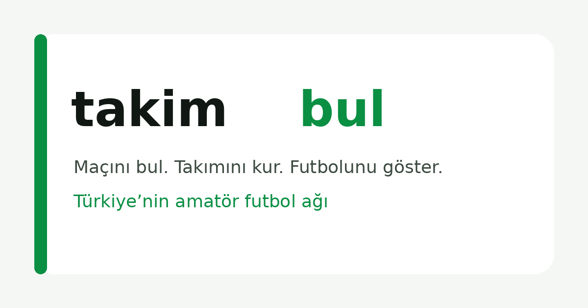
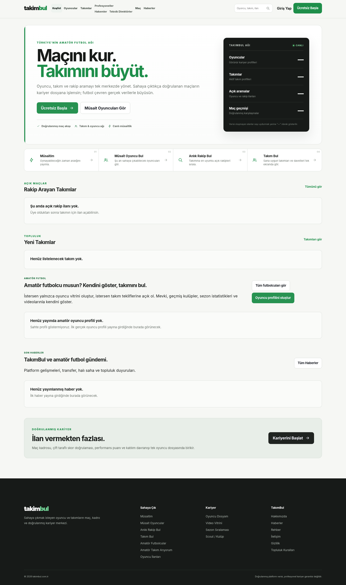
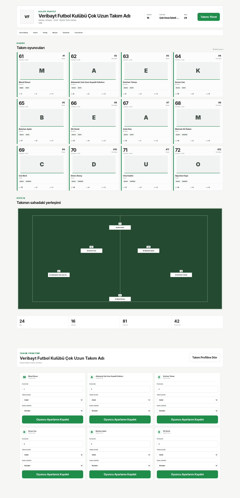
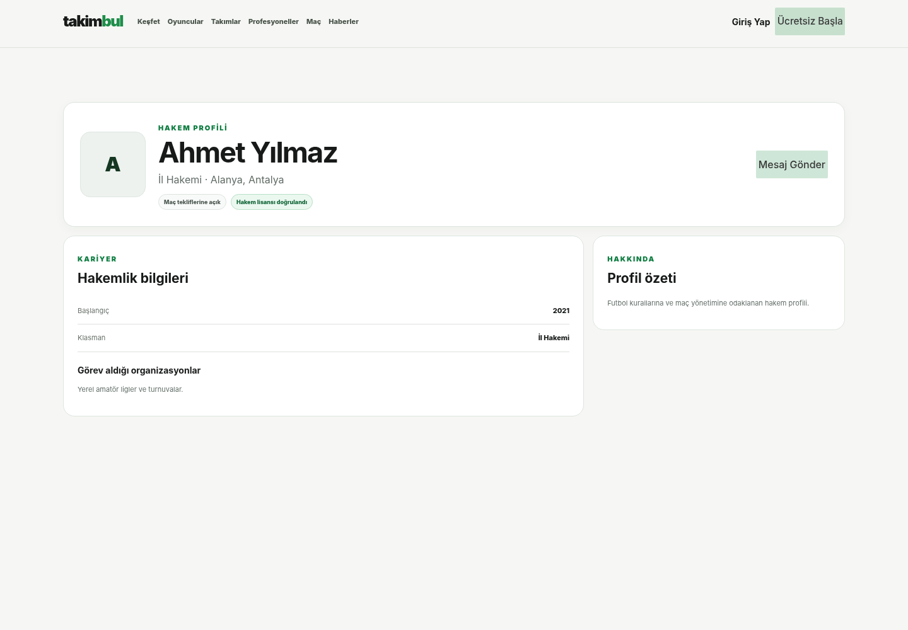
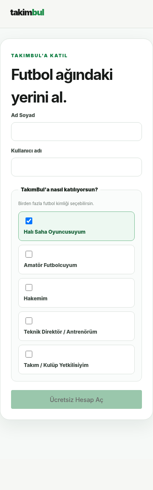
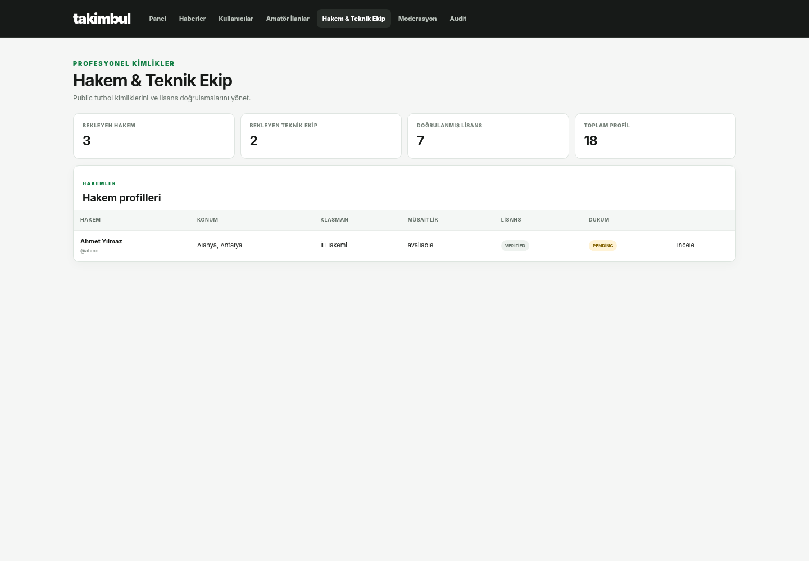
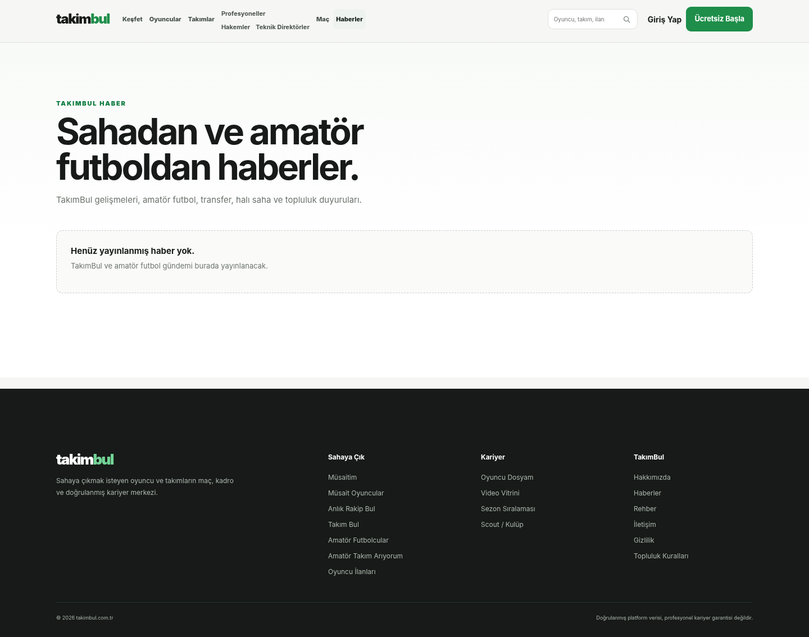
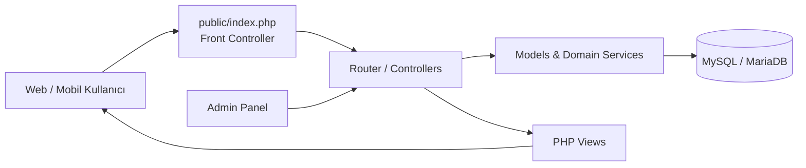

<p align="center">
  
</p>

<h1 align="center">TakımBul</h1>

<p align="center">
  <strong>Türkiye'nin amatör futbol ağı.</strong><br>
  Oyuncuları, takımları, hakemleri, teknik ekipleri, maçları ve futbol kariyerini tek platformda buluşturan web uygulaması.
</p>

<p align="center">
  <a href="https://takimbul.com.tr/"><strong>🌐 Canlı Site</strong></a>
  ·
  <a href="#ekran-görüntüleri">📸 Ekran Görüntüleri</a>
  ·
  <a href="#kurulum">⚙️ Kurulum</a>
  ·
  <a href="#testler">✅ Testler</a>
</p>

<p align="center">
  
  
  
  
  
  
</p>

---

## Proje Hakkında

Bu public portfolio sürümü, **V10.6 kulüp/kadro tabanını**, **V10.7 doğrulama/rol/sponsorlu haber katmanını** ve V10.7.1 görsel hotfix düzeltmelerini koruyan V10.8 Football Identities kaynak ağacını temel alır.

**TakımBul**, amatör futbol ekosistemini tek bir dijital ağda toplamak amacıyla geliştirilen bir web platformudur. Kullanıcılar oyuncu veya takım bulabilir, müsaitlik yayınlayabilir, rakip arayabilir, futbol kariyerlerini sergileyebilir ve farklı futbol kimlikleriyle platformda yer alabilir.

Platform; halı saha oyuncularının yanında **amatör futbolcular, hakemler, teknik direktörler/antrenörler ve kulüp yetkilileri** için ayrı profil ve keşif akışları sunar.

> Bu repository kaynak kodu görünür bir **public portfolio / academic project repository** olarak yayınlanır. Kaynak kodun görünür olması açık kaynak lisansı verildiği anlamına gelmez. Kullanım koşulları için [`LICENSE`](LICENSE) dosyasına bakın.

## Öne Çıkan Özellikler

- ⚽ **Oyuncu Bul / Oyuncu İlanları** — şehir, ilçe, mevki ve seviyeye göre oyuncu keşfi
- 🧑‍💼 **Amatör Futbolcu Vitrini** — kariyer, kulüp geçmişi, istatistik ve video profili
- 🏟️ **Takımlar & Kadro Yönetimi** — çoklu takım üyeliği, forma numarası, kadro durumu ve saha dizilişi
- 🃏 **Squad Cards** — doğrulanmış maç verilerinden üretilen TakımBul Form göstergeleri
- 🧭 **Hakem Ağı** — hakem profili, klasman, lisans ve müsaitlik keşfi
- 🧠 **Teknik Direktör / Antrenör Ağı** — teknik kariyer, lisans, uzmanlık ve takım teknik ekibi
- 🏃 **Müsait Oyuncular** — kısa süreli oynama müsaitliği
- 🤝 **Rakip Bul** — takımlar için maç/rakip eşleşmesi
- 📰 **Haberler** — editoryal içerik, yazar profilleri ve sponsorlu içerik desteği
- ✅ **Doğrulanmış Profiller** — yönetim kontrollü profil doğrulama sistemi
- 🧩 **Çoklu Futbol Kimliği** — tek hesap altında birden fazla futbol rolü
- 🛡️ **Rol Bazlı Yönetim** — Yazar / Yetkili / Süper Yönetici yetki ayrımı
- 📱 **Responsive UI** — mobil, tablet ve masaüstü için ayrı QA testleri
- 🔎 **SEO Altyapısı** — canonical, sitemap, OpenGraph ve yapılandırılmış profil verileri

## Ekran Görüntüleri

Aşağıdaki görüntüler TakımBul'ın gerçek arayüz kodundan alınmıştır. Public repository'de kişisel kullanıcı verisi yayınlamamak için bazı ekranlar test/örnek verisiyle render edilmiştir.

### Ana Sayfa

<p align="center">
  
</p>

### Takım, Kadro ve Saha Dizilişi

<p align="center">
  
</p>

### Hakem Profili

<p align="center">
  
</p>

### Mobil Kayıt ve Futbol Kimliği Seçimi

<p align="center">
  
</p>

### Yönetim — Profesyonel Kimlikler

<p align="center">
  
</p>

### Haberler

<p align="center">
  
</p>

## Teknoloji

| Katman | Teknoloji |
| --- | --- |
| Backend | PHP 8.1+ |
| Veritabanı | MySQL 8 / MariaDB 10.5+ |
| Veri erişimi | PDO |
| Frontend | HTML5, CSS3, Vanilla JavaScript |
| Web sunucusu | Apache + `mod_rewrite` |
| Container | Docker + Docker Compose |
| Test / QA | PHP contract tests, HTTP smoke tests, Playwright/Chromium responsive tests |

## Mimari



Uygulama tek giriş noktası (`public/index.php`) üzerinden route/controller katmanına gider. Domain kuralları model ve servis sınıflarında tutulur; public ve admin görünümleri aynı uygulama çekirdeğini kullanır.

## Futbol Kimlikleri

Tek kullanıcı hesabı aşağıdaki kimliklerden bir veya birkaçına sahip olabilir:

- Halı Saha Oyuncusu
- Amatör Futbolcu
- Hakem
- Teknik Direktör / Antrenör
- Kulüp Yetkilisi

Bu public futbol kimlikleri, admin yetkileri (`writer`, `authorized`, `super_admin`) ile birbirinden ayrıdır.

## Docker ile Çalıştırma

TakımBul, PHP/Apache uygulaması ve MySQL veritabanını birlikte ayağa kaldıran Docker Compose yapılandırması içerir. Yerel makinede PHP veya MySQL kurulu olması gerekmez; yalnızca Docker Desktop / Docker Engine ve Docker Compose yeterlidir.

### 1. Docker ortam dosyasını oluştur

```bash
cp .env.docker.example .env
```

İstersen `.env` içindeki port ve veritabanı parolalarını değiştirebilirsin. Yönetici hesabının otomatik hazırlanmasını istiyorsan `TAKIMBUL_ADMIN_PASSWORD` alanına güçlü bir parola yaz.

### 2. Uygulamayı başlat

```bash
docker compose up -d --build
```

İlk açılışta MySQL temel şemayı yükler; uygulama container'ı veritabanını bekler, güvenli şema onarımını çalıştırır ve ardından Apache'yi başlatır.

Tarayıcıdan:

```text
http://localhost:8080
```

### 3. Durumu kontrol et

```bash
docker compose ps
./scripts/docker-smoke.sh
```

Logları izlemek için:

```bash
docker compose logs -f app db
```

### 4. Container'ları durdur

Verileri koruyarak:

```bash
docker compose down
```

Veritabanı, upload ve runtime volume'larını da tamamen sıfırlamak için:

```bash
docker compose down -v
```

### Docker servisleri

| Servis | Görev |
| --- | --- |
| `app` | PHP 8.2 + Apache, `pdo_mysql`, `mbstring`, `gd`, `opcache` |
| `db` | MySQL 8.0, `utf8mb4` |
| `takimbul_db_data` | Kalıcı veritabanı volume'u |
| `takimbul_uploads` | Kullanıcı uploadları için kalıcı volume |
| `takimbul_storage` | Log/cache/runtime dosyaları için kalıcı volume |

> Docker yapılandırması geliştirme ve demo ortamı içindir. Production ortamında güçlü parolalar, HTTPS reverse proxy ve production `APP_URL` kullan.

## Kurulum

### Gereksinimler

- PHP **8.1+**
- PHP `pdo_mysql`
- MySQL 8 veya MariaDB 10.5+
- Apache `mod_rewrite`

### 1. Repository'yi klonla

```bash
git clone https://github.com/flybyy/takimbul-public.git
cd takimbul-public
```

### 2. Uygulama ayarını oluştur

```bash
cp config/app.example.php config/app.php
```

`config/app.php` içindeki veritabanı ve uygulama ayarlarını kendi ortamına göre düzenle.

> `config/app.php` Git tarafından özellikle takip edilmez. Gerçek şifreleri veya production anahtarlarını repository'ye commit etme.

### 3. Veritabanını hazırla

Temel şema:

```text
database/schema.sql
```

Mevcut/önceki bir TakımBul veritabanını yükseltmek için:

```bash
php scripts/production-repair.php
php scripts/production-repair.php --apply
php scripts/production-repair.php
```

### 4. Yönetici hesabını oluştur

Public repository bilinen/default bir admin parolası içermez. İlk yönetici parolasını ortam değişkeniyle belirle:

```bash
TAKIMBUL_ADMIN_PASSWORD="Guclu-Bir-Parola-123" php scripts/admin-bootstrap.php
```

Parolayı source code, README veya commit mesajına yazma.

### 5. Local geliştirme sunucusu

```bash
php -S 127.0.0.1:8000 -t public public/index.php
```

Ardından:

```text
http://127.0.0.1:8000
```

## DirectAdmin tek klasör kurulumu / Shared Hosting

Tercih edilen yapı domain document root'unu `public/` klasörüne yönlendirmektir.

Hosting paneli bunu desteklemiyorsa proje `public_html/` içine çıkarılabilir. Kök `.htaccess` uygulama klasörlerini web erişimine kapatır ve istekleri `public/index.php` front controller'ına yönlendirir.

Canlı ortamda:

```text
config/app.php
public/uploads/
storage/logs/
```

repository üzerinden overwrite edilmemelidir.

## Testler

Projede PHP contract/regression testleri, gerçek HTTP smoke testleri ve responsive Chromium testleri bulunur.

Örnek:

```bash
php tests/core_test.php
bash tests/http_smoke_test.sh
bash tests/v103_browser_smoke.sh
bash tests/v108_identities_browser_smoke.sh
```

Canlıya çıkış kontrolü:

```bash
php scripts/launch-check.php
php scripts/production-smoke.php
```

## Güvenlik

Public repository **production secrets içermez**.

Git'e eklenmeyen başlıca veriler:

- `config/app.php`
- `.env` ve ortam değişkenleri
- log/cache dosyaları
- gerçek kullanıcı uploadları
- private key / certificate / keystore dosyaları
- production DB dump'ları

Bir güvenlik açığı fark edersen ayrıntılar için [`SECURITY.md`](SECURITY.md) dosyasını kullan.

## Repository ve Lisans

Bu proje kaynak kodu portföy ve akademik inceleme amacıyla public olarak yayınlanmaktadır.

**Public repository ≠ open source license.**

Copyright © 2026 **Murat Sadık Dinçer**. Tüm hakları saklıdır. Kaynak kodun izinsiz kopyalanması, başka bir ödev/proje olarak teslim edilmesi, yeniden dağıtılması veya ticari kullanımı için izin verilmez. Ayrıntılar: [`LICENSE`](LICENSE).

## Proje Sahibi

**Murat Sadık Dinçer**  
Project Owner & Developer

- 🌐 [takimbul.com.tr](https://takimbul.com.tr/)

---

<p align="center">
  <strong>TakımBul — Maçını bul. Takımını kur. Futbolunu göster.</strong>
</p>
